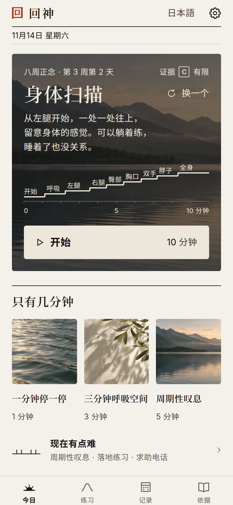
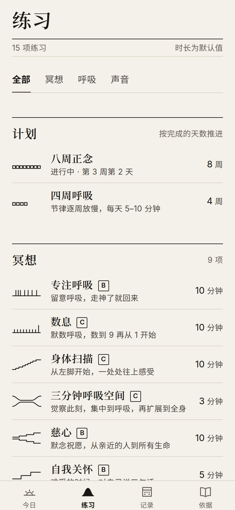
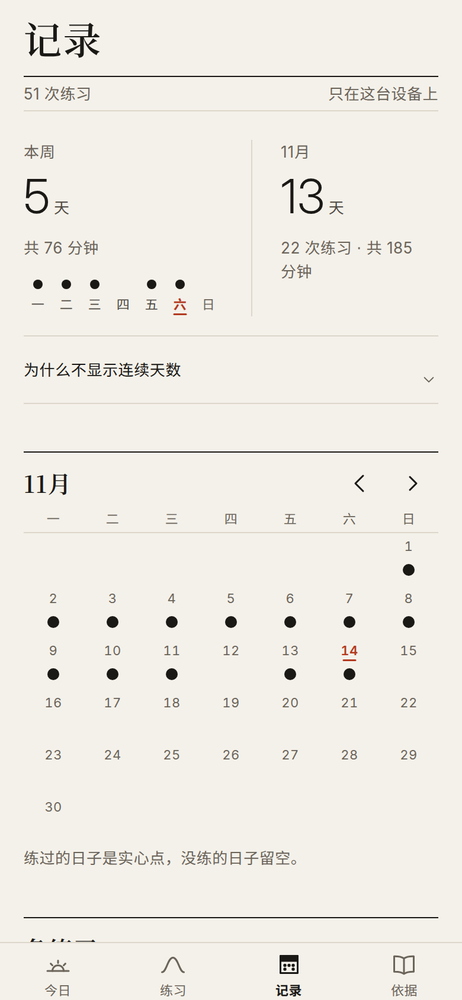

# Huishen 回神

[简体中文](README.zh-CN.md) | **English** | [日本語](README.md)

Meditation, breathing and sound practices designed from the research. Huishen is an installable web app (PWA) with a Chinese and Japanese interface, built for phones first and usable on desktop. It is free, needs no account, and works without a network connection once it has loaded.

Try it: https://huishen.chinnhouhou.com

<p>
  
  
  
  
</p>

Huishen is a tool for practising on your own. It does not replace a doctor, psychotherapy or medication.

## Practices

| Category   | Practices                                                                                                                                                         |
| ---------- | ----------------------------------------------------------------------------------------------------------------------------------------------------------------- |
| Meditation | Focused breathing, breath counting, body scan, three-minute breathing space, loving-kindness, self-compassion, open awareness, one-minute pause, meditation timer |
| Breathing  | Slow breathing, cyclic sighing, box breathing, comfortable pace finder                                                                                            |
| Sound      | Listening for relaxation, listening before sleep (nature sounds, noise and music synthesized in real time, which can be layered)                                  |
| Programs   | Eight weeks of mindfulness, four weeks of breathing                                                                                                               |

## Design decisions

- Every default traces back to research. The Evidence page lists 174 sources, each checked individually. Each card states what the practice was compared with, how large the effect was, the limitations and the results that point the other way. 4-7-8 breathing and hyperventilation methods such as Wim Hof are not offered, and the page explains why.
- No streaks. Records show only how many days and minutes you practised. Programs advance by the days you complete; a missed day does not reshuffle the plan or mark you as behind.
- During a practice, an "If it gets hard" button is always on screen, and the help page opens offline.
- Guidance is text on the screen; there is no voice yet. All sound is synthesized on the device in real time, with no recorded samples, and calibrated for loudness and true peak.
- No accounts and no server that stores user data. Records stay in the browser on the device. The app goes online only to load for the first time and to check for and download new versions. Data can be exported as JSON or CSV, and a JSON export can be imported on another device.
- Reminders are written as a plan, such as "after brushing my teeth, I'll do 3 minutes of breathing; if I'm too tired, just 1 minute", and exported as a calendar file (.ics).
- The pace finder can connect a heart-rate strap over Web Bluetooth (experimental).

## Tech stack

React 19, React Router, Zustand, IndexedDB (idb), Vite, TypeScript, vite-plugin-pwa (Workbox), Web Audio with AudioWorklet, Web Bluetooth. Tests use Vitest, Testing Library and Playwright; linting uses Biome. Fonts are subset to the characters the app uses and served with it, with no dependency on Google Fonts or other external services.

## Running locally

Requires Node.js 20 or later.

```bash
npm ci
npm run dev       # dev server at http://localhost:5173
npm run check     # type check, Biome, Vitest and production build; must pass before committing
npm run e2e       # Playwright end-to-end tests
```

In development builds, adding `?seed=demo` to the URL loads eight weeks of demo data, for example `http://localhost:5173/records?seed=demo`. The interface language can be switched at the top right of the Today page, or with `?lang=ja` or `?lang=zh-CN` in the URL.

## Documentation (in Chinese)

| File                                                       | Contents                                                            |
| ---------------------------------------------------------- | ------------------------------------------------------------------- |
| [docs/PRODUCT.md](docs/PRODUCT.md)                         | Product spec: features, defaults, safety, writing rules             |
| [docs/design/DESIGN.md](docs/design/DESIGN.md)             | Design spec; mockups are in `docs/design/final/`                    |
| [docs/APP.md](docs/APP.md)                                 | App layer: routes, how practices start and finish                   |
| [docs/ARCHITECTURE.md](docs/ARCHITECTURE.md)               | Stack, directory layout and dependency direction                    |
| [docs/modules.md](docs/modules.md)                         | Public interfaces of the engine, audio, data and heart-rate modules |
| [docs/LOCALIZATION.md](docs/LOCALIZATION.md)               | Chinese and Japanese interface                                      |
| [docs/TASKS.md](docs/TASKS.md)                             | Remaining work                                                      |
| [docs/DEPLOYMENT.md](docs/DEPLOYMENT.md)                   | Deployment                                                          |
| [docs/research/evidence.json](docs/research/evidence.json) | Evidence data                                                       |

## Deployment

Hosted on Tencent Cloud EdgeOne Pages; pushing to `main` deploys automatically. The build configuration is in `edgeone.json` at the repository root. See [docs/DEPLOYMENT.md](docs/DEPLOYMENT.md) for details.

## About the screenshots

The images in `docs/screenshots/` are taken by the "README 截图" GitHub Actions workflow, which starts the dev server and loads demo data before capturing. To refresh them, run the workflow by hand from the Actions page.
