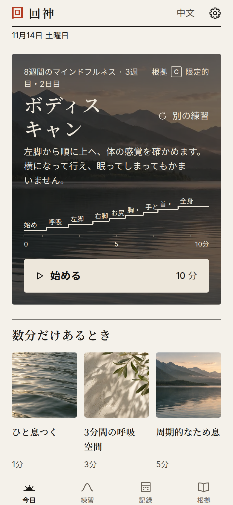
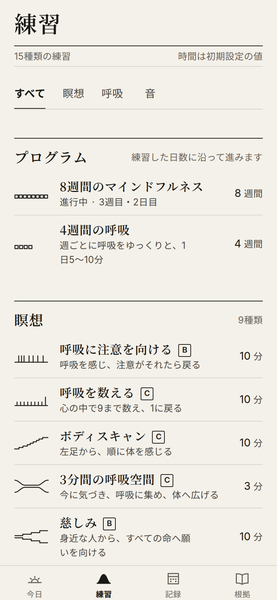
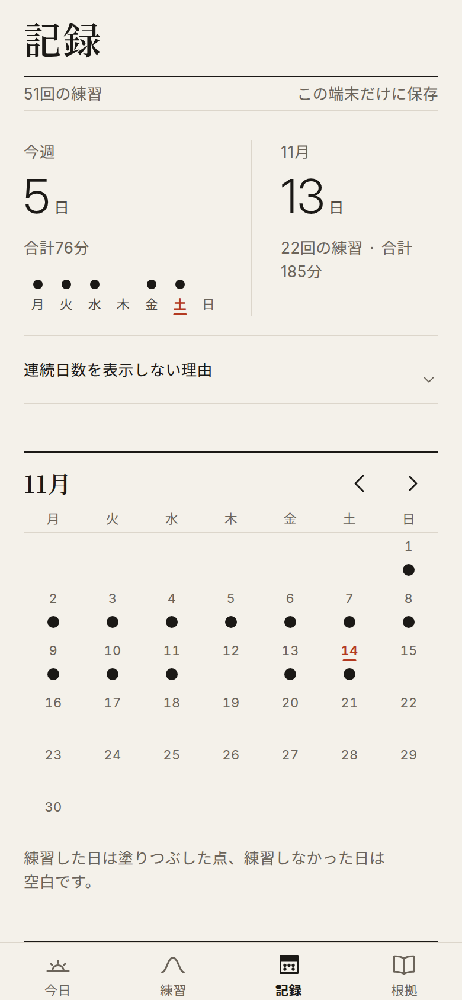

# 回神 Huishen

[简体中文](README.zh-CN.md) | [English](README.en.md) | **日本語**

研究をもとに設計した瞑想・呼吸・音の練習です。インストールできるウェブアプリ（PWA）で、中国語と日本語に対応しています。スマートフォン向けですが、デスクトップでも使えます。無料で登録も不要です。一度読み込めば、ネット接続がなくても使えます。

使ってみる：https://huishen.chinnhouhou.com

<p>
  
  
  
  
</p>

回神は自分で練習するための道具です。医師の診察、心理療法、薬の代わりにはなりません。

## 練習

| 分類       | 内容                                                                                                                                        |
| ---------- | ------------------------------------------------------------------------------------------------------------------------------------------- |
| 瞑想       | 呼吸に注意を向ける、呼吸を数える、ボディスキャン、3分間の呼吸空間、慈しみ、セルフ・コンパッション、開かれた気づき、ひと息つく、瞑想タイマー |
| 呼吸       | ゆっくり呼吸、周期的なため息、ボックス呼吸、心地よい呼吸ペースを探す                                                                        |
| 音         | 音を聴く · 休憩、音を聴く · 就寝前（自然音、ノイズ、リアルタイムに合成した音楽を重ねられます）                                              |
| プログラム | 8週間のマインドフルネス、4週間の呼吸                                                                                                        |

## 方針

- 初期設定はすべて研究にさかのぼれます。「根拠」ページには個別に確認した174件の出典を載せ、各カードに比較の対象、効果の大きさ、限界、反対の結果を書いています。4-7-8呼吸やWim Hofなどの過換気法は採用しておらず、その理由も同じページにあります。
- 連続日数は表示しません。記録するのは練習した日数と時間だけです。プログラムは終えた日数で進み、休んだ日があっても組み直したり、遅れを知らせたりしません。
- 練習中は「つらくなったら」のボタンが常に表示されます。相談先はオフラインでも開けます。
- ガイドは画面の文字で、音声はまだありません。音はすべて端末上でリアルタイムに合成し、録音素材は使っていません。ラウドネスとトゥルーピークも調整しています。
- アカウントも、データを保存するサーバーもありません。記録はこの端末のブラウザーだけに保存され、通信するのは初回の読み込みと新しいバージョンの確認・取得のときだけです。JSONとCSVで書き出せ、JSONは別の端末で読み込めます。
- リマインダーは「歯磨きの後に3分の呼吸をする。疲れていたら1分だけにする」という形で書き、カレンダー用のファイル（.ics）を作れます。
- 心地よい呼吸ペースを探すときに、Web Bluetoothで心拍センサーをつなげます（実験的な機能）。

## 技術スタック

React 19、React Router、Zustand、IndexedDB（idb）、Vite、TypeScript、vite-plugin-pwa（Workbox）、Web AudioとAudioWorklet、Web Bluetooth。テストはVitest、Testing Library、Playwright、静的解析はBiomeです。フォントは使う文字だけのサブセットにしてアプリと一緒に配信し、Google Fontsなどの外部サービスには依存していません。

## ローカルで動かす

Node.js 20以上が必要です。

```bash
npm ci
npm run dev       # 開発サーバー http://localhost:5173
npm run check     # 型チェック、Biome、Vitest、本番ビルド（コミット前に通す）
npm run e2e       # PlaywrightによるE2Eテスト
```

開発ビルドでは、URLに`?seed=demo`を付けると8週間分のデモデータが入ります（例：`http://localhost:5173/records?seed=demo`）。表示言語は「今日」ページの右上で切り替えられるほか、URLに`?lang=ja`または`?lang=zh-CN`を付けても変えられます。

## ドキュメント（中国語）

| ファイル                                                   | 内容                                                           |
| ---------------------------------------------------------- | -------------------------------------------------------------- |
| [docs/PRODUCT.md](docs/PRODUCT.md)                         | プロダクト仕様：機能、初期設定、安全、文言のルール             |
| [docs/design/DESIGN.md](docs/design/DESIGN.md)             | デザイン仕様。デザインカンプは`docs/design/final/`             |
| [docs/APP.md](docs/APP.md)                                 | アプリ層：ルーティング、練習の開始と終了の流れ                 |
| [docs/ARCHITECTURE.md](docs/ARCHITECTURE.md)               | 技術構成、ディレクトリ、依存の向き                             |
| [docs/modules.md](docs/modules.md)                         | エンジン、音、データ、心拍の各モジュールの公開インターフェース |
| [docs/LOCALIZATION.md](docs/LOCALIZATION.md)               | 中国語と日本語の切り替え                                       |
| [docs/TASKS.md](docs/TASKS.md)                             | 残っている作業                                                 |
| [docs/DEPLOYMENT.md](docs/DEPLOYMENT.md)                   | デプロイ                                                       |
| [docs/research/evidence.json](docs/research/evidence.json) | 根拠のデータ                                                   |

## デプロイ

Tencent CloudのEdgeOne Pagesでホストしており、`main`にpushすると自動でデプロイされます。ビルド設定はリポジトリ直下の`edgeone.json`にあります。詳しくは[docs/DEPLOYMENT.md](docs/DEPLOYMENT.md)を参照してください。

## スクリーンショットについて

`docs/screenshots/`の画像は、GitHub Actionsの「README 截图」ワークフローが撮影しています。開発サーバーを起動し、デモデータを入れてから撮ります。更新するときはActionsのページから手動で実行してください。
