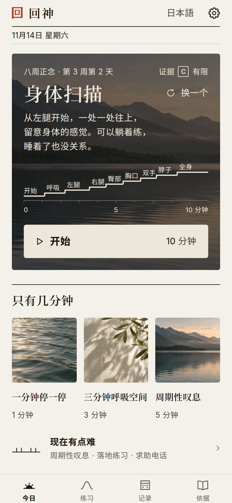
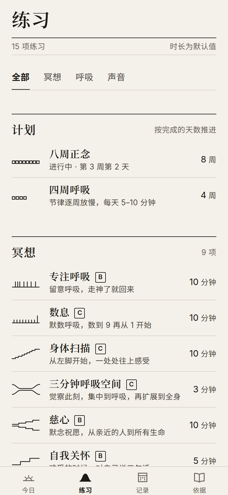
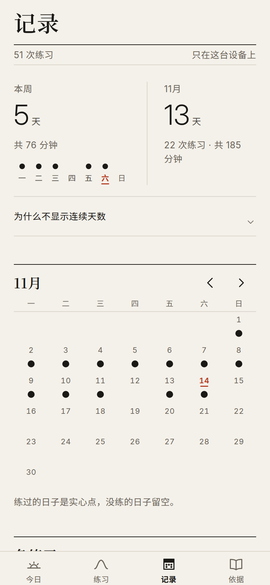

# 回神

**简体中文** | [English](README.en.md) | [日本語](README.md)

依据研究设计的冥想、呼吸与声音练习。可以安装的网页应用（PWA），中文和日文界面，手机优先，桌面也能用。免费，不用注册，打开过一次之后，没有网络也能用。

在线使用：https://huishen.chinnhouhou.com

<p>
  
  
  
  
</p>

回神是自我练习的工具，不能替代医生、心理治疗或药物。

## 练习

| 类别 | 内容                                                                                       |
| ---- | ------------------------------------------------------------------------------------------ |
| 冥想 | 专注呼吸、数息、身体扫描、三分钟呼吸空间、慈心、自我关怀、开放觉察、一分钟停一停、静坐计时 |
| 呼吸 | 慢呼吸、周期性叹息、箱式呼吸、舒适节律探索                                                 |
| 声音 | 听声音 · 放松、听声音 · 睡前（自然声、噪声和实时合成的音乐，可以叠加）                     |
| 计划 | 八周正念、四周呼吸                                                                         |

## 几个做法

- 默认值都能追溯到研究。「依据」页收录 174 条逐条核对过的出处，每张卡片写明和什么比较、效应大小、局限和相反的结果。4-7-8 呼吸、Wim Hof 等过度换气法没有采用，原因也写在这一页。
- 不显示连续天数，只记练了几天、多少分钟。计划按完成到第几天推进，漏一天不重排，也不提示落后。
- 播放器里「不舒服？」始终可见，求助方式断网也能打开。
- 引导是屏幕上的文字，暂时没有语音。所有声音都在设备上实时合成，没有用录音素材，响度和真峰值都经过校准。
- 没有账号，也没有保存数据的服务器。记录只存在这台设备的浏览器里，只在第一次打开、检查和下载新版本时联网。可以导出 JSON 和 CSV，JSON 能在另一台设备上导入。
- 提醒按「在刷牙后，我会做 3 分钟呼吸；如果太累，就只做 1 分钟」的句式来写，生成日历文件（.ics）。
- 舒适节律探索时，可以用 Web Bluetooth 连接心率带（实验功能）。

## 技术

React 19、React Router、Zustand、IndexedDB（idb）、Vite、TypeScript、vite-plugin-pwa（Workbox）、Web Audio 与 AudioWorklet、Web Bluetooth。测试用 Vitest、Testing Library 和 Playwright，代码检查用 Biome。字体按实际用到的字做成子集，和应用一起托管，不依赖 Google Fonts 等外部服务。

## 本地运行

需要 Node.js 20 或更高版本。

```bash
npm ci
npm run dev       # 开发服务器 http://localhost:5173
npm run check     # 类型检查、Biome、Vitest 和生产构建，提交前要通过
npm run e2e       # Playwright 端到端测试
```

开发构建里，地址后面加 `?seed=demo` 会写入 8 周的演示数据，例如 `http://localhost:5173/records?seed=demo`。界面语言在「今日」页右上角切换，也可以在地址后加 `?lang=ja` 或 `?lang=zh-CN`。

## 文档

| 文件                                                       | 内容                                     |
| ---------------------------------------------------------- | ---------------------------------------- |
| [docs/PRODUCT.md](docs/PRODUCT.md)                         | 产品规格：功能、默认值、安全、文案规范   |
| [docs/design/DESIGN.md](docs/design/DESIGN.md)             | 设计规格，设计稿在 `docs/design/final/`  |
| [docs/APP.md](docs/APP.md)                                 | 应用层：路由、开始和结束练习的流程       |
| [docs/ARCHITECTURE.md](docs/ARCHITECTURE.md)               | 技术栈、目录和依赖方向                   |
| [docs/modules.md](docs/modules.md)                         | 引擎、声音、数据、心率四个模块的公开接口 |
| [docs/LOCALIZATION.md](docs/LOCALIZATION.md)               | 中日文界面                               |
| [docs/TASKS.md](docs/TASKS.md)                             | 剩余任务                                 |
| [docs/DEPLOYMENT.md](docs/DEPLOYMENT.md)                   | 部署                                     |
| [docs/research/evidence.json](docs/research/evidence.json) | 依据数据                                 |

## 部署

托管在腾讯云 EdgeOne Pages，推送 `main` 后自动部署。构建配置在根目录的 `edgeone.json`，详见 [docs/DEPLOYMENT.md](docs/DEPLOYMENT.md)。

## README 截图

`docs/screenshots/` 里的图由 GitHub Actions 的「README 截图」工作流生成：启动开发服务器，写入演示数据后截图。需要更新时，在 Actions 页面手动运行。
